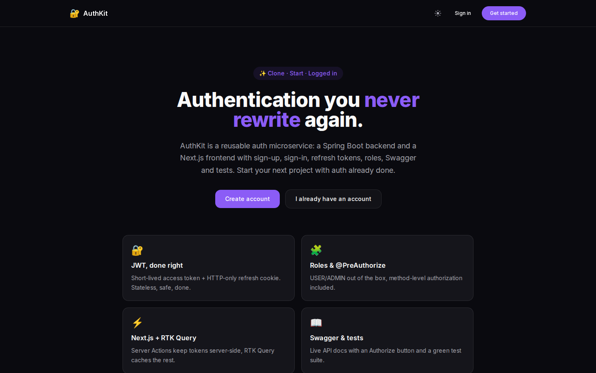
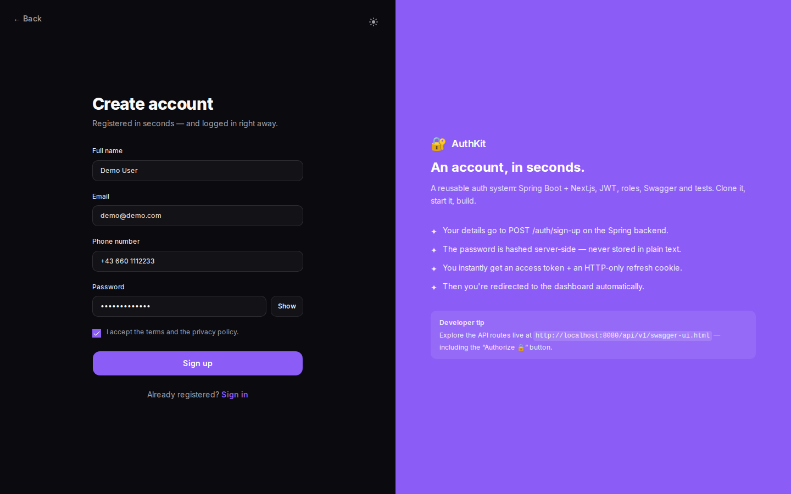
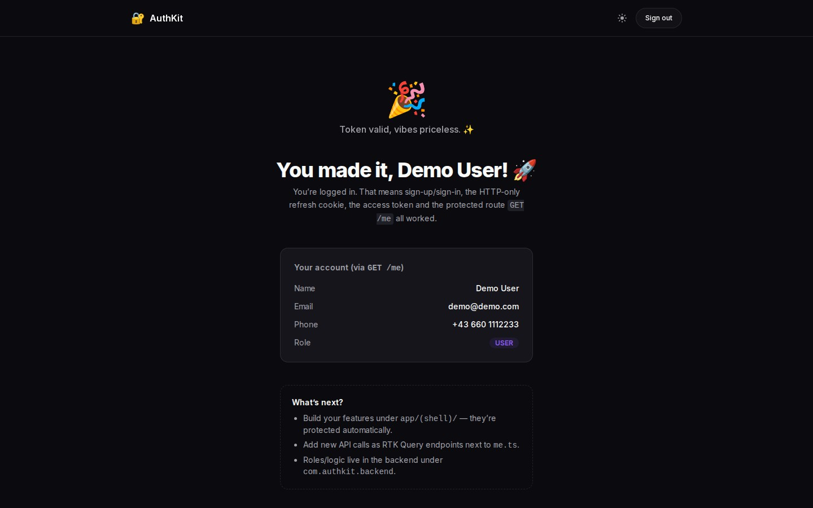
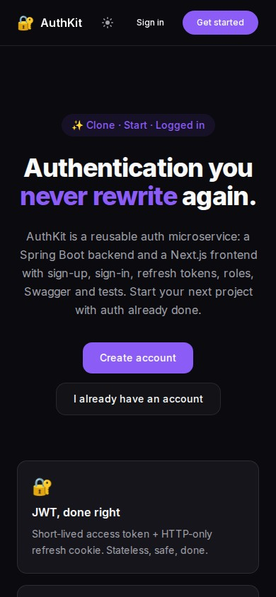
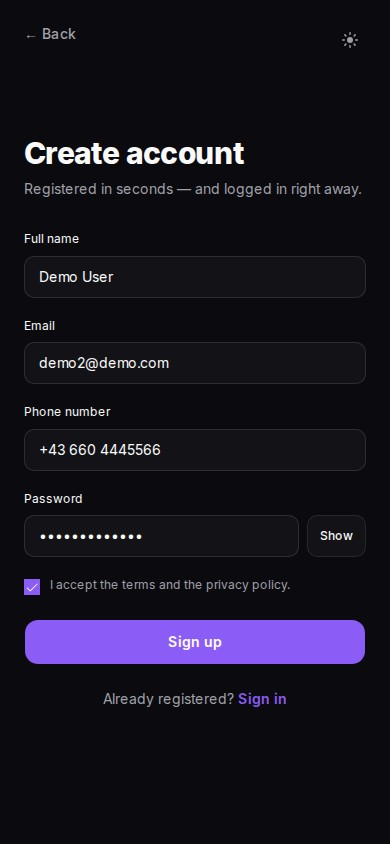
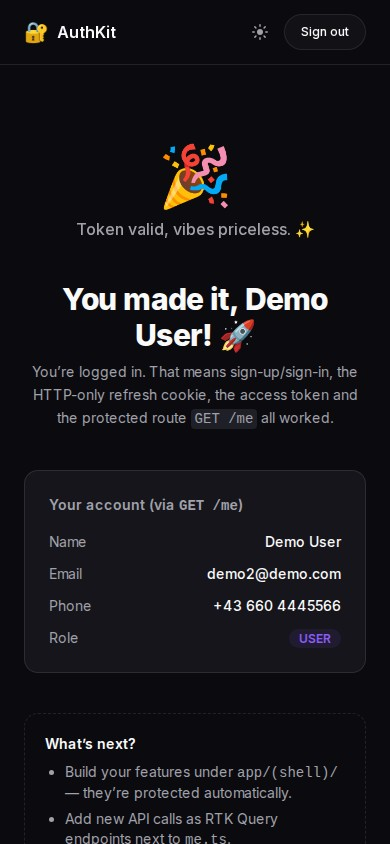
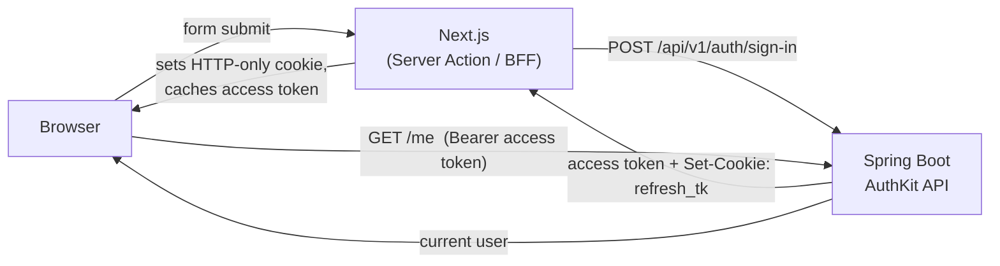

# 🔐 AuthKit

[](https://github.com/Umex10/authkit/actions/workflows/backend-verify-ci.yml)
[](https://github.com/Umex10/authkit/actions/workflows/web-build-ci.yml)
[](https://github.com/Umex10/authkit/actions/workflows/web-unit-ci.yml)
[](https://github.com/Umex10/authkit/actions/workflows/web-e2e-ci.yml)
[](https://github.com/Umex10/authkit/pkgs/container/authkit-backend)

> A reusable, drop-in **authentication microservice** — clone it, start it, and you have working sign-up, sign-in, JWT sessions, roles, Swagger and tests on day one.

AuthKit is a small monorepo with a **Spring Boot** auth backend and a **Next.js** web app that implements the complete, production-style auth flow against it ([how to use it](#-how-to-use-it)):

- ✅ Sign-up & sign-in with server-side validation
- ✅ Short-lived **access token** (15 min) + long-lived **refresh token** (30 days) in an **HTTP-only cookie**
- ✅ Stateless JWT security (RS256), role-based authorization (`USER` / `ADMIN`; sign-up always creates a `USER`)
- ✅ A public **JWKS endpoint**, so other services verify tokens themselves
- ✅ A protected example route (`GET /me`) and an admin-only route (`@PreAuthorize`)
- ✅ Live **Swagger UI** with an `Authorize 🔒` button
- ✅ Modern frontend: Next.js App Router + Server Actions + **Redux Toolkit Query**; route protection via `proxy.ts` / `AuthProvider`, silent token renewal, expired sessions lead back to sign-in
- ✅ Tests everywhere: Spring unit/slice/integration tests, Vitest unit tests and Playwright e2e for the web app
- ✅ One `docker compose up` away from running; the backend is also published as a versioned image on ghcr.io
- ✅ GitHub Actions for everything: backend tests, web build/unit/e2e, Docker image build and publish

It was extracted, almost 1:1, from a production app — so it is not a toy. Use it as the starting point for any new project that needs auth, and as a reference for how the pieces fit together.

---

## 📸 A look at it

<table>
<tr>
<td width="50%" valign="top">
  
  <sub><b>Landing</b> — what you get out of the box.</sub>
</td>
<td width="50%" valign="top">
  
  <sub><b>Sign-up</b> — validation, terms; posts to <code>/auth/sign-up</code>. Every new account is a <code>USER</code>.</sub>
</td>
</tr>
<tr>
<td colspan="2" valign="top">
  
  <sub><b>Dashboard</b> — you land here logged in; the account card is live data from the protected <code>GET /me</code> route.</sub>
</td>
</tr>
</table>

**On mobile** — the same web app, responsive:

<table>
<tr>
<td width="33%"></td>
<td width="33%"></td>
<td width="33%"></td>
</tr>
</table>

---

## 🧭 How to use it

The heart of AuthKit is the **backend in `apps/backend`** — a self-contained
**authentication microservice**. `apps/web` is its reference client.

- **Building a web app?** Start from `apps/web`: the sign-up/sign-in forms, the
  HTTP-only refresh cookie (via Server Actions) and the route guards are done.
- **Already have an app?** Run `apps/backend` as a standalone auth service and
  point your app at its HTTP API (`/api/v1/auth/**`, `/api/v1/me`, …). Other
  backend services verify the tokens with the public key from
  `/api/v1/.well-known/jwks.json`. `apps/web` then doubles as a **copy-paste
  reference** for the client side: forms, validation (`lib/validation.ts`),
  RTK Query layer, token renewal and route guards.

See [docs/ARCHITECTURE.md](docs/ARCHITECTURE.md) for the full flow.

---

## 🚀 Quick start (the 60-second version)

```bash
# 0. Create the JWT signing keys (once after cloning; never overwrites)
scripts/generate-jwt-keys.sh

# 1. Start the database + backend (+ a mirrored Swagger UI)
docker compose up -d

# 2. …then start the web frontend (Next.js)
cd apps/web
npm install
npm run dev          # → http://localhost:3000
```

Open **http://localhost:3000**, register — and you land on a dashboard that says *"You made it!"* 🎉

> No configuration needed: every value has a sensible default. Only the JWT keys are created per clone (step 0; when you run the backend without Docker it creates them itself). See [docs/RUNNING.md](docs/RUNNING.md) for all the variations (full Docker, manual dev, individual services) and for [production keys](docs/RUNNING.md#jwt-keys).

---

## 🐳 Prebuilt backend image

Every release is published to the GitHub Container Registry:

```bash
docker pull ghcr.io/umex10/authkit-backend:1.0.0   # or :latest
```

The image ships without keys: mount a key pair and point
`JWT_PRIVATE_KEY_LOCATION` / `JWT_PUBLIC_KEY_LOCATION` at it — see
[docs/RUNNING.md](docs/RUNNING.md#jwt-keys) and [docs/CI.md](docs/CI.md).

---

## 🗺️ What's in the box

```
authkit/
├── apps/
│   ├── backend/        Spring Boot 4 · Java 21 · JWT · Spring Security · springdoc
│   └── web/            Next.js 16 · React 19 · Redux Toolkit Query · Tailwind v4 · shadcn/ui
├── .github/workflows/         CI: backend + web tests, Docker build/publish
├── docker-compose.yml         Postgres + backend + Swagger UI
├── docker-compose.test.yml    Throwaway Postgres for e2e tests
├── scripts/                   generate-jwt-keys.sh
└── docs/                      You are here-ish
```

---

## 📚 Documentation

| Document | What it covers |
|----------|----------------|
| [docs/ARCHITECTURE.md](docs/ARCHITECTURE.md) | How it all fits together + **flow diagrams** (who calls whom, in what order) |
| [docs/BACKEND_FLOW.md](docs/BACKEND_FLOW.md) | **Detailed backend call graph** — controller → service → repository → DB, per endpoint, incl. the security filter chain |
| [docs/RUNNING.md](docs/RUNNING.md) | Every way to run it, all Docker instances, ports and environment variables |
| [docs/SWAGGER.md](docs/SWAGGER.md) | Using the live API docs and the `Authorize 🔒` button |
| [docs/TESTING.md](docs/TESTING.md) | Backend unit/slice/integration tests, web unit tests, Playwright e2e |
| [docs/SECURITY.md](docs/SECURITY.md) | The token/cookie model and what to harden before production |
| [docs/CI.md](docs/CI.md) | The GitHub Actions workflows, the published Docker image and how to make a release |
| [docs/CUSTOMIZING.md](docs/CUSTOMIZING.md) | Change the roles, add endpoints, re-theme, and remove the fun gag |

---

## 🧭 The auth flow at a glance



Full sequence diagrams (sign-up, sign-in, silent refresh, protected request) live in [docs/ARCHITECTURE.md](docs/ARCHITECTURE.md). For the **detailed backend call graph** — every hop from controller through service to repository and database, plus the security filter chain — see [docs/BACKEND_FLOW.md](docs/BACKEND_FLOW.md).

---

## 🔌 API surface

| Method | Route | Auth | Purpose |
|--------|-------|------|---------|
| `POST` | `/api/v1/auth/sign-up` | public | Create an account, returns access token + sets refresh cookie |
| `POST` | `/api/v1/auth/sign-in` | public | Authenticate, returns access token + sets refresh cookie |
| `GET`  | `/api/v1/auth/access-tk` | refresh cookie | Exchange the refresh cookie for a fresh access token |
| `GET`  | `/api/v1/me` | access token | The current user (example protected route) |
| `GET`  | `/api/v1/admin/ping` | access token + `ADMIN` | Role-protected example route |
| `GET`  | `/api/v1/.well-known/jwks.json` | public | Public key (JWKS) for services that verify AuthKit tokens |

Explore them live at **http://localhost:8080/api/v1/swagger-ui.html**.

---

## 🛠️ Tech stack

**Backend:** Spring Boot 4, Java 21, Spring Security, JJWT, Spring Data JPA, PostgreSQL / H2, springdoc-openapi.
**Web frontend:** Next.js 16 (App Router), React 19, Redux Toolkit Query, react-hook-form + Zod, Tailwind CSS v4, shadcn/ui, sonner.
**Testing:** JUnit 5 + Mockito + MockMvc + Spring Security Test + JaCoCo, Vitest + Testing Library, Playwright.

---

## 📄 License

Use it, fork it, build on it. AuthKit is meant to be copied into your own projects.
