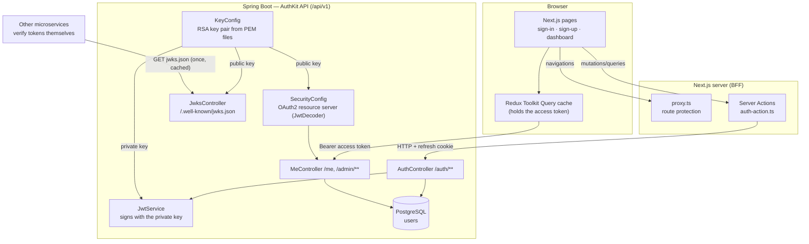
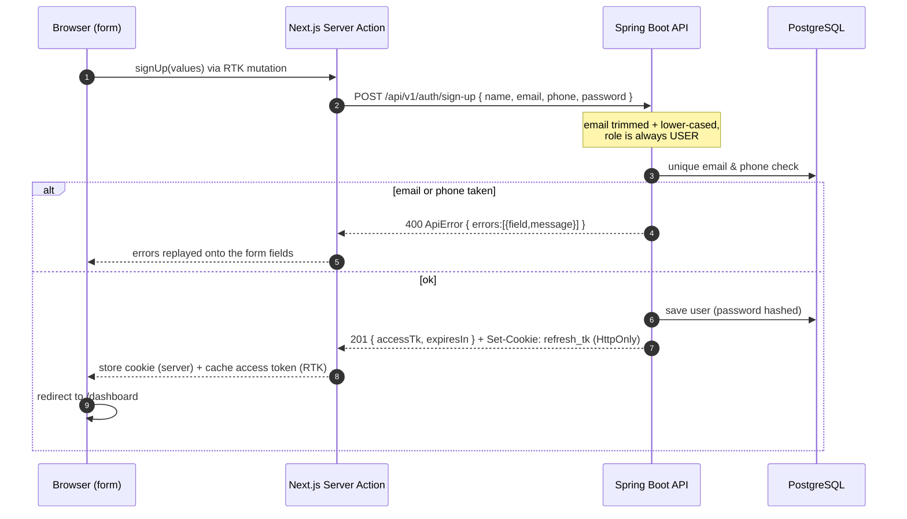
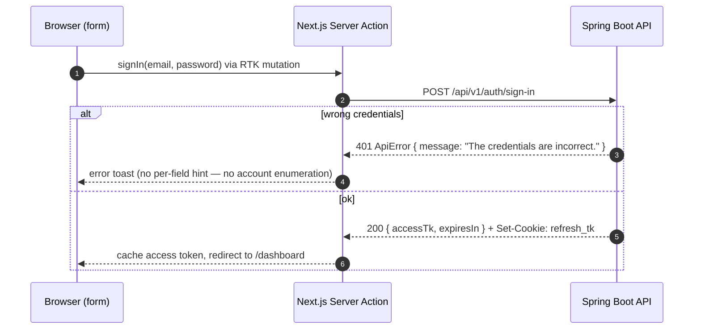
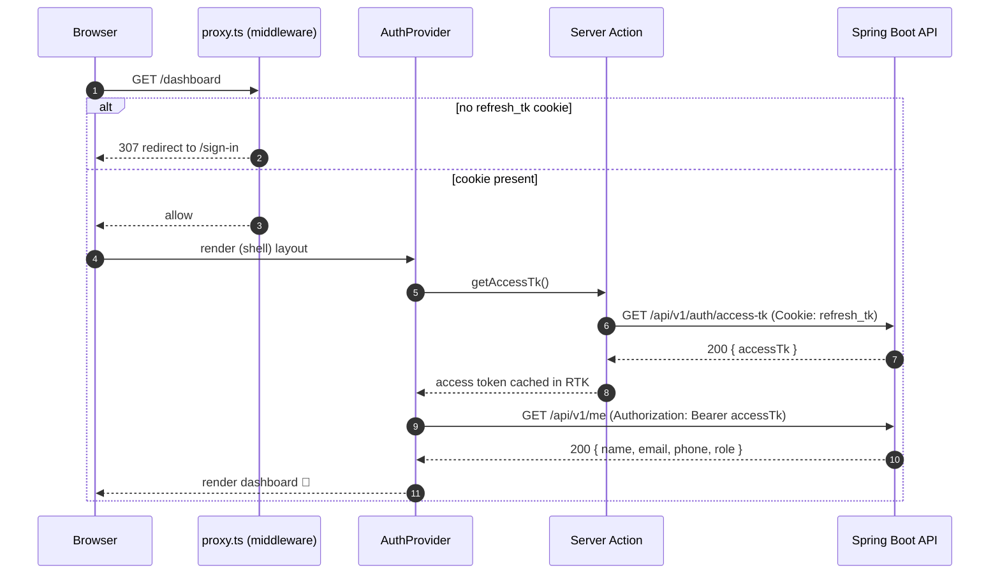
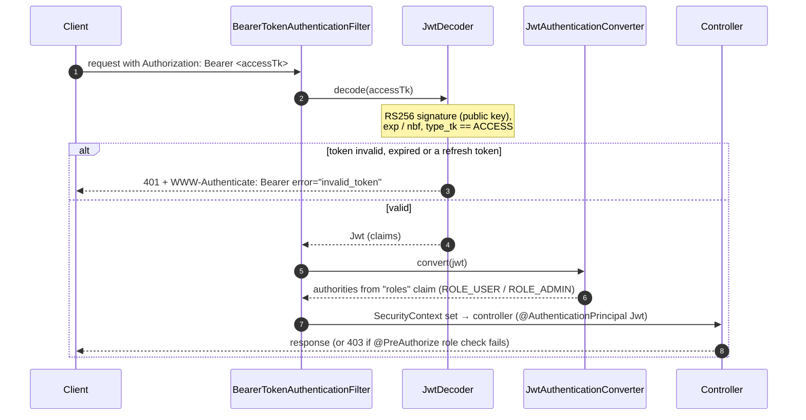
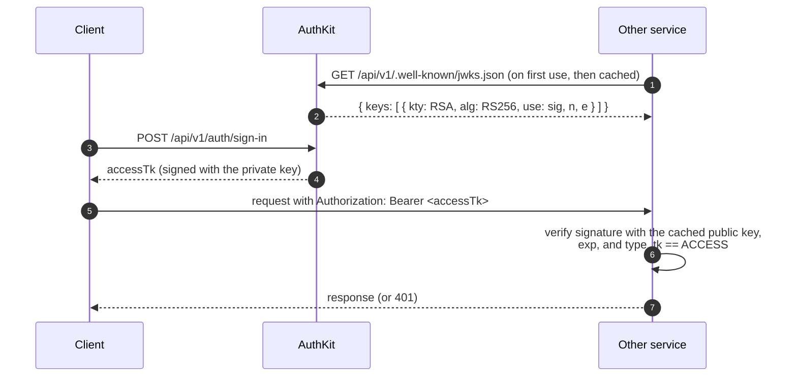

# Architecture & flow diagrams

This document explains how AuthKit's pieces fit together and — most importantly —
**which service calls which, and in what order**. All diagrams are Mermaid, so
GitHub renders them automatically.

---

## 1. The components

**Why a BFF?** The auth calls go through **Next.js Server Actions**, not directly
from the browser. That lets the server read/write the `refresh_tk` cookie as
**HTTP-only** — it is never exposed to client-side JavaScript. The short-lived
access token, by contrast, lives only in the RTK Query cache in memory and is
attached as a `Bearer` header to normal API calls.

---

## 2. Sign-up

---

## 3. Sign-in

---

## 4. Loading the protected dashboard (silent refresh + /me)

### When the session cannot be restored

`proxy.ts` only checks that the cookie **exists**, not that it is valid. If the
backend rejects it (expired, signed with a key that was replaced, or the account
was deleted), `AuthProvider` deletes the cookie and sends the user to
`/sign-in?session=expired`, which shows "Your session has expired". Without that
step the user would sit on an empty dashboard, and `/sign-in` would keep sending
them back because the cookie is still there.

### Access token expiry while the page stays open

The access token lives 15 minutes. When an API call comes back `401`, the shared
RTK Query base query fetches a new access token with the refresh cookie and
repeats the call once (parallel calls share one renewal). If the renewal fails
too, the case above applies.

### The reverse: already signed in

The same cookie check works the other way around. If you **already** have a
`refresh_tk` cookie and open the landing page (`/`), `/sign-in` or `/sign-up`,
`proxy.ts` sends you **straight to `/dashboard`** — no reason to show the
marketing or auth pages again. The landing-page redirect adds a `?redirected=1`
flag, and the dashboard shows a short "you're already signed in" note so the
convenience redirect is visible rather than magic. (The AuthKit logo in the
header intentionally links to `/`, so clicking it from the dashboard demonstrates
this exact bounce.)

---

## 5. How a request gets authenticated on the backend

All of this is Spring Security's built-in **OAuth2 resource server**, configured
in `SecurityConfig`; there is no custom filter. The token alone is enough: no
database lookup happens before the controller. `MeController` reads the user id
from the token's `sub` claim. See [SECURITY.md](SECURITY.md) for the details.

> Want the *fully detailed* call graph — every hop from controller through
> service to repository and database, the bean dependency graph and the filter
> chain order? See **[BACKEND_FLOW.md](BACKEND_FLOW.md)**.

---

## 6. Token & cookie model

| Token | Lifetime | Where it lives | Sent how |
|-------|----------|----------------|----------|
| **Access token** | 15 minutes | RTK Query cache (memory) | `Authorization: Bearer …` header |
| **Refresh token** | 30 days | `refresh_tk` cookie: HTTP-only, SameSite=Lax, Secure in production | browser cookie jar → Next.js Server Actions (BFF) → backend |

The backend is **stateless** — it stores no sessions. Signing out simply deletes
the refresh cookie; any still-valid access token expires on its own within 15
minutes.

---

## 7. Verifying AuthKit tokens in another service (JWKS)

Other services never receive the private key and never ask AuthKit whether a
token is valid. They fetch the **public** key once and verify every token
locally.

In a Spring service this is one property, `spring.security.oauth2.resourceserver.jwt.jwk-set-uri`,
pointing at the JWKS URL, plus the `type_tk == ACCESS` validator (see
[SECURITY.md](SECURITY.md)). The integration test
`BackendApplicationTests#shouldVerifyAccessTkWithPublishedJwks` plays exactly
this role.
