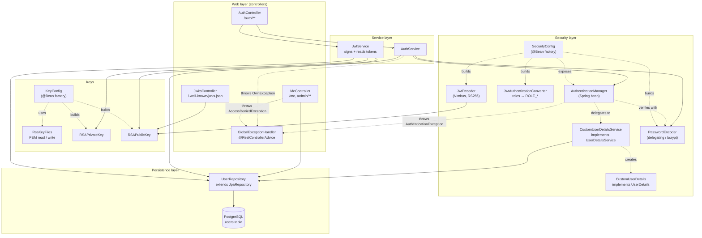
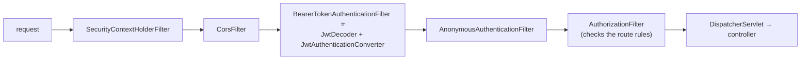
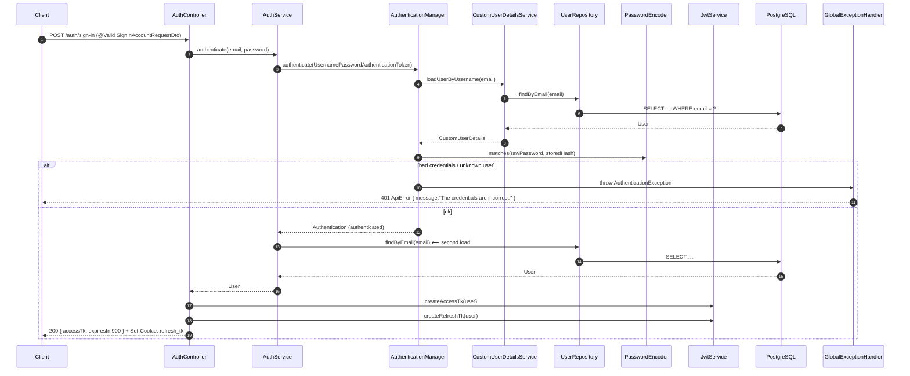
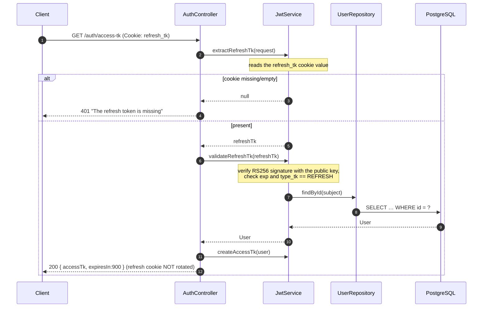
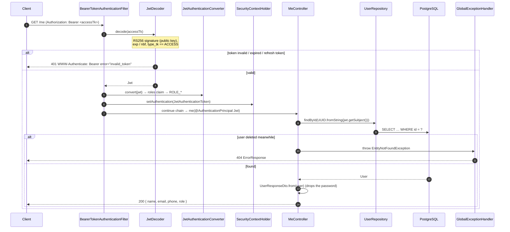
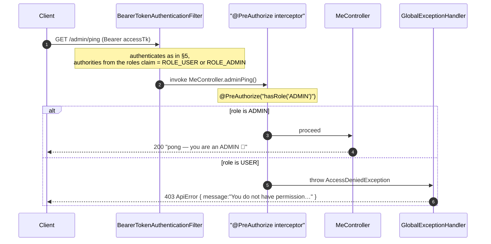

# Backend flow — in detail (controller → service → repository → DB)

This document traces **every call** the Spring Boot backend makes, per endpoint,
all the way from the controller down to the repository and the database, including
the security filter chain and the error branches. If [ARCHITECTURE.md](ARCHITECTURE.md)
is the bird's-eye view, this is the wiring diagram.

All diagrams are Mermaid (rendered automatically by GitHub).

---

## 0. Bean / dependency graph

Who is injected into whom (constructor injection via Lombok `@RequiredArgsConstructor`),
grouped by layer.



> `UserDetailsService` is an interface; the concrete bean is
> `CustomUserDetailsService`. It is only used for the **password check on
> sign-in** (through the `AuthenticationManager`). Requests with a bearer token
> never touch it: the `JwtDecoder` verifies the token on its own.
>
> On startup, before any bean exists, `DevKeyGenerator` writes a dev key pair
> through `RsaKeyFiles` when no key files are there yet (local runs only; see
> [RUNNING.md](RUNNING.md#jwt-keys)).

---

## 1. The security filter chain (runs before every controller)

Order of the filters in the one `SecurityFilterChain` built by `SecurityConfig`.
There is no custom filter: `.oauth2ResourceServer(...)` adds Spring's
`BearerTokenAuthenticationFilter`.



Route rules (from `SecurityConfig.securityFilterChain`):

| Matcher | Rule |
|---------|------|
| `OPTIONS /**` | permit all (CORS pre-flight) |
| `/auth/**` | permit all (public) |
| `/.well-known/jwks.json` | permit all (public key for other services) |
| `/swagger-ui/**`, `/v3/api-docs/**` | permit all |
| everything else | `authenticated()` |

> A request **without** a token simply passes `BearerTokenAuthenticationFilter`
> and is rejected by the `AuthorizationFilter` on protected routes (401). A
> request with an **invalid** token is rejected by the filter itself (401 with
> `WWW-Authenticate: Bearer error="invalid_token"`).

---

## 2. `POST /auth/sign-up`

```mermaid
sequenceDiagram
    autonumber
    participant C as Client
    participant AC as AuthController
    participant AS as AuthService
    participant UR as UserRepository
    participant PE as PasswordEncoder
    participant JS as JwtService
    participant DB as PostgreSQL
    participant GEH as GlobalExceptionHandler

    C->>AC: POST /auth/sign-up (@Valid SignUpAccountRequestDto)
    Note over AC: @Valid runs Bean Validation first;<br/>failure → MethodArgumentNotValidException → GEH → 400
    AC->>AS: signUp(dto)
    AS->>UR: findByEmail(email)
    UR->>DB: SELECT … WHERE email = ?
    DB-->>UR: Optional<User>
    UR-->>AS: Optional<User>
    AS->>UR: findByPhone(phone)
    UR->>DB: SELECT … WHERE phone = ?
    DB-->>AS: Optional<User>

    alt email or phone already taken
        AS->>GEH: throw OwnException(fieldErrors)
        GEH-->>C: 400 ApiError { errors:[{field,message}] }
    else unique
        AS->>PE: encode(rawPassword)
        PE-->>AS: "{bcrypt}…" hash
        AS->>UR: save(User{…, password=hash})
        UR->>DB: INSERT INTO users …
        DB-->>AS: persisted User (with generated UUID)
        AS-->>AC: User
        AC->>JS: createAccessTk(user)
        JS-->>AC: access JWT (15 min, RS256)
        AC->>JS: createRefreshTk(user)
        JS-->>AC: refresh JWT (30 days, RS256)
        Note over AC: adds Cookie refresh_tk (HttpOnly, Path=/, 30d)
        AC-->>C: 201 { accessTk, expiresIn:900 } + Set-Cookie: refresh_tk
    end
```

---

## 3. `POST /auth/sign-in`

Note the two steps: the `AuthenticationManager` verifies the credentials (it
loads the user through `CustomUserDetailsService` and checks the password), and
then `AuthService` loads the `User` entity again, because the tokens need its id
and role.



> **Detail worth knowing:** the user is loaded **twice** on sign-in — once
> inside the `AuthenticationManager` and once in `AuthService`. It's correct,
> just a minor optimization opportunity.

---

## 4. `GET /auth/access-tk` (silent refresh)



> Any invalid refresh cookie → **401** "The credentials are incorrect.": an
> access token sent as refresh cookie fails the `type_tk` check, and a broken
> signature, an expired or a malformed token is turned into a
> `BadCredentialsException` inside `JwtService` (handled like a wrong password).

---

## 5. `GET /me` (protected route — the full chain)

The resource server authenticates the request from the token alone; the
controller then loads the user by the id in the token's `sub` claim.



---

## 6. `GET /admin/ping` (role-based authorization)



---

## 7. Where each thing lives

| Concern | Class | Path |
|---------|-------|------|
| Public auth endpoints | `AuthController` | `auth/AuthController.java` |
| Sign-up rules + credential check | `AuthService` | `auth/AuthService.java` |
| JWT create (RS256) + refresh-token check | `JwtService` | `auth/JwtService.java` |
| Per-request auth (JwtDecoder, roles converter) | `SecurityConfig` | `auth/security/config/SecurityConfig.java` |
| Key pair as beans | `KeyConfig` | `auth/config/KeyConfig.java` |
| PEM key files: read, write, generate | `RsaKeyFiles` | `auth/config/RsaKeyFiles.java` |
| Dev key pair on first start | `DevKeyGenerator` | `auth/config/DevKeyGenerator.java` |
| Public key for other services | `JwksController` | `auth/JwksController.java` |
| Principal lookup | `CustomUserDetailsService` | `auth/security/CustomUserDetailsService.java` |
| `User` → `UserDetails` adapter | `CustomUserDetails` | `auth/security/CustomUserDetails.java` |
| Protected example routes | `MeController` | `user/MeController.java` |
| Entity | `User` | `common/entities/User.java` |
| Repository | `UserRepository` | `common/repositories/UserRepository.java` |
| Error → HTTP mapping | `GlobalExceptionHandler` | `common/exception/GlobalExceptionHandler.java` |
| Swagger / Authorize button | `OpenApiConfig` | `config/OpenApiConfig.java` |
